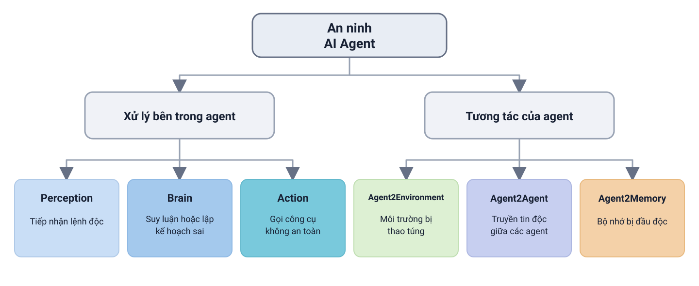

# Bản đồ an ninh AI Agent

<!--
Mục tiêu: người nghe xác định được rủi ro có thể xuất hiện ở đâu trong một AI agent. Theo taxonomy của Deng et al. (2025), nhánh Intra-Execution gồm Perception, Brain, Action; nhánh Interaction gồm Agent2Environment, Agent2Agent, Agent2Memory. Sơ đồ xếp taxonomy thành ba tầng hình kim tự tháp để người nghe thấy cấu trúc từ tổng quan đến nhóm rủi ro cụ thể. Hai nhánh là góc nhìn phân loại, không phải các giai đoạn tách biệt theo thời gian. Mỗi ô nêu một ví dụ rủi ro. Sáu màu khớp với các nhóm risk source trong bảng tổng quan; màu không biểu thị mức độ nghiêm trọng. Các nhánh có thể nối tiếp nhau: lệnh độc từ web ảnh hưởng suy luận, được lưu trong memory rồi kích hoạt tool.
-->
