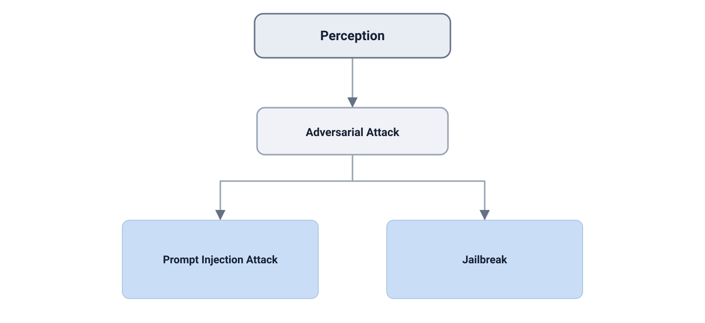

# Perception: dữ liệu thành mệnh lệnh

<!--
GHI CHÚ THUYẾT TRÌNH

[click]

Ở đầu vào, agent có thể nhầm dữ liệu với chỉ dẫn cần làm theo.

Phân biệt hai kiểu: prompt injection làm lệch nhiệm vụ; jailbreak tìm cách vượt ràng buộc an toàn. Hai kiểu có thể chồng lấn. Lệnh độc nằm trong trang web hay tài liệu truy xuất là indirect injection, sẽ nói ở phần tương tác với môi trường.
-->
