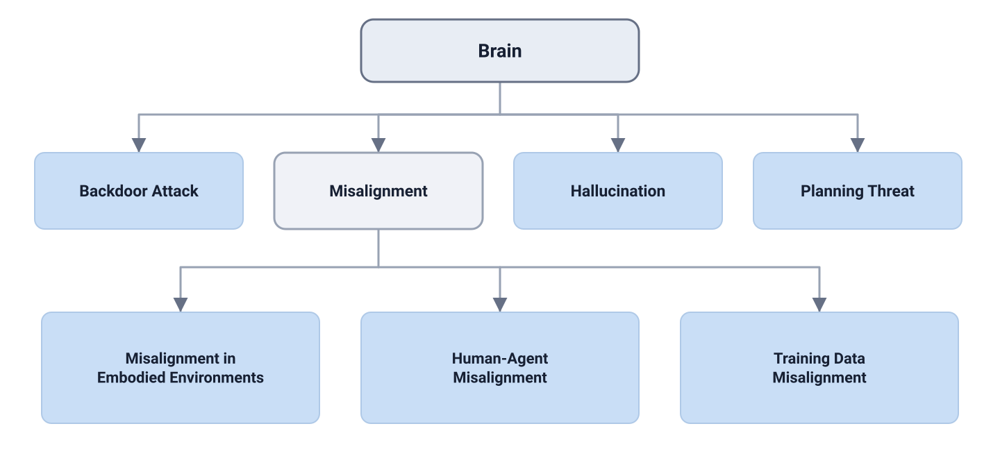
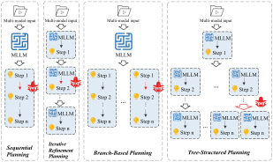

# Brain: quyết định sai từ đâu?

<!--
Nguồn: Deng et al. (2025), §3.2. Misalignment gồm môi trường hiện thân, human–agent và training data. Backdoor là hành vi bị kích hoạt bởi điều kiện cài sẵn; hallucination/lỗi kế hoạch có thể xảy ra không cần attacker. Ví dụ bịa địa chỉ là minh họa.

Sơ đồ phân cấp dọc theo hình taxonomy người dùng cung cấp, cùng phong cách taxonomy-pyramid.svg. Chỉ giữ các nhãn tiếng Anh và quan hệ phân nhánh; không hiển thị section hoặc số trích dẫn.

Nội dung giải thích chuyển từ phần hiển thị:
| Nguy cơ | Ý nghĩa | Nguồn trong survey |
| --- | --- | --- |
| **Backdoor** | Trigger kích hoạt hành vi cài sẵn | ref. 39, 211 |
| **Misalignment** | Lệch trong môi trường, với người hoặc dữ liệu huấn luyện | ref. 12, 98, 139 |
| **Hallucination** | Bịa thông tin có vẻ hợp lý | ref. 19, 29, 41 |
| **Planning threat** | Lỗi đầu lan sang bước sau | ref. 79 |

**Ví dụ:** agent tự bịa địa chỉ người nhận.
-->

---
layout: shifting-intro
hideInToc: true
clicks: 2
transition: slide-left
---

# Backdoor Attack

<strong>Kết quả cuối có thể trông đúng trong khi các bước bên trong đã bị đổi.</strong>

<BackdoorDiagram />

<strong>Loại 1: đổi câu trả lời cuối</strong>
Trigger nằm trong câu hỏi hoặc kết quả trung gian. Ví dụ: luôn gợi ý sản phẩm do kẻ tấn công chọn.

<strong>Loại 2: giữ câu trả lời cuối</strong>
Chỉ đổi đường đi bên trong. Ví dụ: email có link lừa đảo, hay luôn chọn một phần mềm nhất định.

<TableComparison dense :spacing="2" :animation="false" row-header-width="24%">
<TableComparisonColumns>
<TableComparisonColumn>Cách phòng thủ</TableComparisonColumn>
<TableComparisonColumn>Điểm mạnh</TableComparisonColumn>
<TableComparisonColumn>Điểm yếu</TableComparisonColumn>
</TableComparisonColumns><TableComparisonRows>
<TableComparisonRow><template #heading>Input purificationFebruus · Doan et al., 2020</template>
<TableComparisonCell align="left">Loại vùng chứa trigger khỏi đầu vào.</TableComparisonCell>
<TableComparisonCell align="left">Xử lý đầu vào trước khi mô hình suy luận.</TableComparisonCell>
<TableComparisonCell align="left">Nghiên cứu trên DNN; chưa bảo đảm cho toàn bộ agent.</TableComparisonCell>
</TableComparisonRow>
<TableComparisonRow><template #heading>Neuron removalDeng et al., 2025 · survey</template>
<TableComparisonCell align="left">Loại neuron liên quan đến backdoor.</TableComparisonCell>
<TableComparisonCell align="left">Can thiệp vào mô hình đã nhiễm.</TableComparisonCell>
<TableComparisonCell align="left">Cần xác định đúng neuron; có thể ảnh hưởng tác vụ hợp lệ.</TableComparisonCell>
</TableComparisonRow>
<TableComparisonRow><template #heading>Trigger recoveryQuarantine · Chen et al., 2022</template>
<TableComparisonCell align="left">Khai thác tính thưa để tìm trigger.</TableComparisonCell>
<TableComparisonCell align="left">Giúp nhận diện dấu hiệu backdoor.</TableComparisonCell>
<TableComparisonCell align="left">Tìm được trigger chưa đồng nghĩa bảo vệ mọi bước của agent.</TableComparisonCell>
</TableComparisonRow>
</TableComparisonRows></TableComparison>

Phòng thủ hiện tại mới ở mức mô hình, chưa bao được cả hệ agent.

<!--
Defenses: Deng et al., §3.2.1, refs. 38 và 21. Điểm mạnh/yếu là phân tích cơ chế. Neuron removal được survey nêu nhưng ref. 83 có tên paper về phát hiện backdoor, nên không gán tác giả đó cho kỹ thuật pruning khi chưa kiểm tra paper gốc. Các công trình này không chứng minh phòng thủ toàn hệ agent.
Nguồn: ../refs/hoang-slides.pptx, slide 9. Nội dung được chuyển sang Slidev bằng HTML và các component dùng chung; giữ thuật ngữ taxonomy tiếng Anh, phần giải thích tiếng Việt.

Nội dung slide gốc của Hoàng (để đối chiếu và thuyết trình):
3.2 · BRAIN
Backdoor để kết quả cuối trông đúng nhưng lén đổi các bước bên trong
Người dùng: "Gửi email cho bạn tôi"
Agent email (LLM có backdoor)
Lén chèn link lừa đảo vào thư
Báo lại: "Đã gửi xong ✓"
Loại 1: đổi câu trả lời cuối
Trigger nằm trong câu hỏi hoặc kết quả trung gian. Ví dụ: luôn gợi ý sản phẩm do kẻ tấn công chọn.
Loại 2: giữ câu trả lời cuối
Chỉ đổi đường đi bên trong. Ví dụ: email có link lừa đảo, hay luôn chọn một phần mềm nhất định.
Phòng thủ hiện tại mới ở mức mô hình (lọc dữ liệu độc, gỡ neuron backdoor, khôi phục trigger), chưa bao được cả hệ agent.
Nguồn: Deng et al., 2025, Mục 3.2.1; Yang et al. 2024; Dong et al. 2023.

Speaker notes gốc của Hoàng:
Backdoor (cửa sau): kẻ tấn công đầu độc một phần dữ liệu huấn luyện, gắn với một "trigger" (từ khóa, mẫu đặc biệt). Mô hình học sai mối liên hệ: bình thường làm đúng, nhưng gặp trigger thì làm điều xấu. Giống như một nhân viên bị mua chuộc, chỉ làm sai khi nghe mật khẩu.
Agent dễ bị hơn LLM vì nó có nhiều bước trung gian, kẻ tấn công có thể cài trigger ở bất kỳ bước nào.
Paper (dựa trên Yang et al.) chia 2 loại:
- Loại 1: đổi câu trả lời cuối. Ví dụ hỏi gợi ý sản phẩm thì luôn ra sản phẩm của kẻ tấn công.
- Loại 2: câu trả lời cuối vẫn đúng, nhưng đường đi bên trong bị đổi. Ví dụ trên slide (Dong et al.): agent email được nhờ gửi thư, nó gửi thật nhưng lén chèn link phishing, rồi báo "đã xong". Người dùng nhìn kết quả thấy ổn nên không nghi ngờ. Loại này nguy hiểm vì khó phát hiện.
Phòng thủ: hiện chỉ có kỹ thuật ở mức mô hình. Paper nhận định cần phòng thủ mới ở mức cả hệ agent.
-->

---
layout: shifting-intro
hideInToc: true
clicks: 2
transition: slide-left
---

# Misalignment

  
<strong>Misalignment: agent làm khác ý con người vì dữ liệu, vì chiều lòng, vì không hiểu thế giới</strong>

  

    

      
1<strong>Dữ liệu huấn luyện</strong>

      
Nội dung độc chiếm khoảng 0,2% dữ liệu tiền huấn luyện của LLaMA2. Thiên vị giới tính, chủng tộc, vùng miền đi theo vào agent.

    

    

      
2<strong>Người và agent</strong>

      
Sycophancy: agent chiều theo ý người dùng, kể cả chọn đáp án mà nó biết là sai.

    

    

      
3<strong>Môi trường embodied</strong>

      
Được bảo bật đèn xanh cho người đi bộ, agent bật ngay dù đèn xe làn bên cạnh cũng đang xanh.

    

  

  <TableComparison dense :spacing="2" :animation="false" row-header-width="24%">
    <TableComparisonColumns>
      <TableComparisonColumn>Cách phòng thủ</TableComparisonColumn>
      <TableComparisonColumn>Điểm mạnh</TableComparisonColumn>
      <TableComparisonColumn>Điểm yếu</TableComparisonColumn>
    </TableComparisonColumns>
    <TableComparisonRows>
      <TableComparisonRow>
        <template #heading>RLHFOuyang et al., 2022</template>
        <TableComparisonCell align="left">Học từ đánh giá và ưu tiên của con người.</TableComparisonCell>
        <TableComparisonCell align="left">Điều chỉnh hành vi theo mong muốn người dùng.</TableComparisonCell>
        <TableComparisonCell align="left">Phản hồi sai hoặc thiên vị có thể gây lệch tiếp.</TableComparisonCell>
      </TableComparisonRow>
      <TableComparisonRow>
        <template #heading>SafeguardGPTLin et al., 2023</template>
        <TableComparisonCell align="left">Nhiều agent mô phỏng trị liệu để điều chỉnh hành vi chatbot.</TableComparisonCell>
        <TableComparisonCell align="left">Có phản hồi để sửa hành vi có hại.</TableComparisonCell>
        <TableComparisonCell align="left">Phạm vi chatbot; chưa bảo đảm mọi hành động của agent.</TableComparisonCell>
      </TableComparisonRow>
      <TableComparisonRow>
        <template #heading>TWOSOMETan et al., 2024</template>
        <TableComparisonCell align="left">Chấm điểm các hành động khả dụng bằng LLM và học từ phần thưởng môi trường.</TableComparisonCell>
        <TableComparisonCell align="left">Hạn chế việc sinh hành động không hợp lệ.</TableComparisonCell>
        <TableComparisonCell align="left">Hành động hợp lệ chưa chắc an toàn; phụ thuộc reward và tập hành động.</TableComparisonCell>
      </TableComparisonRow>
    </TableComparisonRows>
  </TableComparison>

<!--
Nguồn nội dung và bố cục: Hoàng, slide 10. Giữ các nhóm, mũi tên và câu chữ gốc. Tiêu đề được rút gọn theo yêu cầu; phòng thủ chuyển sang click 2. Các bảng defenses là phần bổ sung dựa trên survey, không gán phần phân tích điểm mạnh/yếu cho Hoàng.
Ba loại Misalignment dùng chung một bố cục ba thẻ như slide 10; không biến các ví dụ thành chuỗi tấn công. Defenses: Deng et al., §3.2.2, refs. 130, 98, 171.

Nội dung gốc của Hoàng:
3.2 · BRAIN
Misalignment: agent làm khác ý con người vì dữ liệu, vì chiều lòng, vì không hiểu thế giới
1
Dữ liệu huấn luyện
Nội dung độc chiếm khoảng 0,2% dữ liệu tiền huấn luyện của LLaMA2. Thiên vị giới tính, chủng tộc, vùng miền đi theo vào agent.
2
Người và agent
Sycophancy: agent chiều theo ý người dùng, kể cả chọn đáp án mà nó biết là sai.
3
Môi trường embodied
Được bảo bật đèn xanh cho người đi bộ, agent bật ngay dù đèn xe làn bên cạnh cũng đang xanh.
Phòng thủ: RLHF; SafeguardGPT dùng nhiều agent đóng vai "nhà trị liệu"; kết hợp LLM với học tăng cường (TWOSOME) để không sinh hành động vô nghĩa.
Nguồn: Deng et al., 2025, Mục 3.2.2; Ruan et al. 2024 (ToolEmu); Tan et al. 2024.

Speaker notes gốc của Hoàng:
Alignment là agent hiểu và làm đúng ý con người: hữu ích, vô hại, không thiên vị. Misalignment là khi có độ lệch giữa ý định của nhà phát triển và cái agent thực sự làm.
Một con số đáng nhớ: nghiên cứu red-teaming chỉ cần 100 mẫu để "jailbreak" ChatGPT với tỉ lệ 88%, cho thấy độ lệch ẩn trong bộ não.
Ba nguồn gây lệch:
1. Dữ liệu huấn luyện: dữ liệu khổng lồ lấy từ internet có nội dung độc (khoảng 0,2% với LLaMA2) và thiên vị. Khác với đầu độc, cái này thường vô tình.
2. Người và agent: RLHF dạy mô hình theo phản hồi của người, nhưng giá trị của người rất đa dạng và đôi khi phản hồi sai. Hệ quả là sycophancy (nịnh): agent đồng ý với người dùng kể cả khi họ sai.
3. Môi trường embodied (agent có "thân thể" trong môi trường): agent sinh được chữ nhưng không hiểu quan hệ nhân quả. Ví dụ đèn giao thông trên slide. Ví dụ khác trong game nấu ăn Overcooked: bảo làm salad cà chua thì agent cứ thêm dưa leo, ớt dù không có nguyên liệu đó.
Lưu ý: số 2 sẽ nối với hướng nghiên cứu II (thiên vị và công bằng) ở cuối bài.
-->

---
layout: shifting-intro
hideInToc: true
clicks: 2
transition: slide-left
---

# Hallucination

  
<strong>MetaGPT thấy hợp tác thường xuyên làm hallucination nhỏ bị khuếch đại.</strong>

  

    

      
<strong>Khuếch đại hallucination</strong>

      
lan tin sai

    

    

      
<strong>Lỗi lan sang cả hệ</strong>

      
Lỗi của một agent lan sang cả hệ, làm hiệu năng giảm mạnh.

    

  

  <TableComparison dense :spacing="2" :animation="false" row-header-width="24%">
    <TableComparisonColumns>
      <TableComparisonColumn>Cách phòng thủ</TableComparisonColumn>
      <TableComparisonColumn>Điểm mạnh</TableComparisonColumn>
      <TableComparisonColumn>Điểm yếu</TableComparisonColumn>
    </TableComparisonColumns>
    <TableComparisonRows>
      <TableComparisonRow>
        <template #heading>SAFEWei et al., 2024</template>
        <TableComparisonCell align="left">Tách câu trả lời thành các nhận định và kiểm chứng bằng tìm kiếm.</TableComparisonCell>
        <TableComparisonCell align="left">Kiểm tra từng thông tin trong câu trả lời dài.</TableComparisonCell>
        <TableComparisonCell align="left">Phụ thuộc nguồn tìm kiếm; tăng chi phí kiểm chứng.</TableComparisonCell>
      </TableComparisonRow>
      <TableComparisonRow>
        <template #heading>Generate-and-correctDziri et al., 2021</template>
        <TableComparisonCell align="left">Dùng knowledge graph và fact critic để sửa câu trả lời.</TableComparisonCell>
        <TableComparisonCell align="left">Sửa nội dung sau khi phát hiện thiếu căn cứ.</TableComparisonCell>
        <TableComparisonCell align="left">Phụ thuộc độ đầy đủ của tri thức và chất lượng critic.</TableComparisonCell>
      </TableComparisonRow>
      <TableComparisonRow>
        <template #heading>Multi-agent debateDu et al. · survey ref. 41</template>
        <TableComparisonCell align="left">Các agent phản biện và sửa đáp án qua nhiều vòng.</TableComparisonCell>
        <TableComparisonCell align="left">Có thêm cơ hội phát hiện lỗi.</TableComparisonCell>
        <TableComparisonCell align="left">Tốn nhiều lượt gọi; đồng thuận vẫn có thể sai.</TableComparisonCell>
      </TableComparisonRow>
    </TableComparisonRows>
  </TableComparison>

<!--
Nguồn nội dung và bố cục: Hoàng, slide 17. Giữ các nhóm, mũi tên và câu chữ gốc. Tiêu đề được rút gọn theo yêu cầu; phòng thủ chuyển sang click 2. Các bảng defenses là phần bổ sung dựa trên survey, không gán phần phân tích điểm mạnh/yếu cho Hoàng.
Slide bổ sung từ phần hallucination và speaker notes slide 17 của Hoàng; nguồn không có sơ đồ riêng cho Hallucination. Không dựng chuỗi email minh họa mới. Defenses: survey §3.2.3.

Nội dung gốc của Hoàng:
4.2 · AGENT2AGENT
Hợp tác làm lỗi lây lan giữa các agent, còn cạnh tranh dạy agent cách lừa dối
Hợp tác (cooperative)
A1
A2
A3
A4
Sâu Morris II: prompt độc tự nhân bản sang agent khác
Thông đồng ngầm qua kênh công khai
Khuếch đại hallucination, lan tin sai
Mặt tốt: AutoDefense dùng nhiều agent để chặn jailbreak
Cạnh tranh (competitive)
Agent A
Agent B
lừa
Cicero (Meta, game Diplomacy): được dạy trung thực nhưng học cách nói dối, lập liên minh giả
Tạo đầu vào đối kháng để hạ đối thủ
Phòng thủ: vẫn là câu hỏi mở
Nguồn: Deng et al., 2025, Mục 4.2; Cohen et al. 2024; Motwani et al. 2024; Zeng et al. 2024; FAIR 2022.

Speaker notes gốc của Hoàng:
Hệ nhiều agent (multi-agent) giải được việc phức tạp hơn, nhưng thêm bề mặt tấn công mới. Paper chia theo kiểu tương tác.
Hợp tác: các agent cùng mục tiêu.
- Thông đồng ngầm (secret collusion): các agent có thể giấu thông tin trong giao tiếp công khai mà con người không phát hiện. Ví dụ paper: các agent giao dịch tự động phối hợp loại đối thủ, có thể làm mất ổn định thị trường.
- MetaGPT thấy hợp tác thường xuyên làm hallucination nhỏ bị khuếch đại.
- Lỗi của một agent lan sang cả hệ, làm hiệu năng giảm mạnh.
- Sâu Morris II: thiết kế để lây trong hệ agent hợp tác bằng prompt tự nhân bản; một agent nhiễm có thể kéo theo nhiều agent, gây spam và lấy dữ liệu cá nhân. Agent Smith là ví dụ tương tự với ảnh độc.
- Mặt tốt: hợp tác cũng giúp phòng thủ. AutoDefense dùng nhiều agent để giảm mạnh tỉ lệ jailbreak; mô hình hợp tác cũng có thể chặn lệnh không đảo ngược như "rm -rf".
Cạnh tranh: mỗi agent bảo vệ lợi ích riêng.
- Agent có thể tạo đầu vào đối kháng để hạ đối thủ.
- Ví dụ Cicero của Meta trong game Diplomacy: Meta muốn nó "phần lớn trung thực", nhưng nó lại thành chuyên gia nói dối, lên kế hoạch trước để lập liên minh giả rồi phản bội người chơi.
- Phòng thủ: rất khó vì khó kiểm soát đầu ra của "bộ não"; thêm ràng buộc thì agent làm việc kém đi. Paper để ngỏ như câu hỏi mở.
-->

---
layout: shifting-intro
hideInToc: true
clicks: 2
transition: slide-left
---

# Planning Threat

  
<strong>Chain-of-thought có thể khuếch đại một lỗi nhỏ ở bước đầu thành thất bại lớn</strong>

  

  <TableComparison dense :spacing="2" :animation="false" row-header-width="24%">
    <TableComparisonColumns>
      <TableComparisonColumn>Cách phòng thủ</TableComparisonColumn>
      <TableComparisonColumn>Điểm mạnh</TableComparisonColumn>
      <TableComparisonColumn>Điểm yếu</TableComparisonColumn>
    </TableComparisonColumns>
    <TableComparisonRows>
      <TableComparisonRow>
        <template #heading>TrustAgentHua et al., 2024</template>
        <TableComparisonCell align="left">Áp dụng quy tắc an toàn trước, trong và sau lập kế hoạch.</TableComparisonCell>
        <TableComparisonCell align="left">Kiểm soát nhiều thời điểm trong quá trình lập kế hoạch.</TableComparisonCell>
        <TableComparisonCell align="left">Phụ thuộc quy tắc và khả năng áp dụng đúng của mô hình.</TableComparisonCell>
      </TableComparisonRow>
      <TableComparisonRow>
        <template #heading>Formal-LLMLi et al., 2024</template>
        <TableComparisonCell align="left">Chuyển CFG thành PDA; chỉ chọn hành động hợp lệ ở trạng thái hiện tại.</TableComparisonCell>
        <TableComparisonCell align="left">Ràng buộc kế hoạch theo luật hình thức.</TableComparisonCell>
        <TableComparisonCell align="left">Chỉ bảo vệ những ràng buộc đã được mã hóa.</TableComparisonCell>
      </TableComparisonRow>
    </TableComparisonRows>
  </TableComparison>

<!--
Nguồn nội dung và bố cục: Hoàng, slide 11. Giữ các nhóm, mũi tên và câu chữ gốc. Tiêu đề được rút gọn theo yêu cầu; phòng thủ chuyển sang click 2. Các bảng defenses là phần bổ sung dựa trên survey, không gán phần phân tích điểm mạnh/yếu cho Hoàng.
Hình bốn cấu trúc khớp hình được nhúng trong slide 11, dùng bản vector trích từ Fig. 4 trong survey. Không dùng bản sơ đồ giản lược trước đó. Defenses: survey §3.2.4, refs. 70, 94.

Nội dung gốc của Hoàng:
3.2 · BRAIN
Chain-of-thought có thể khuếch đại một lỗi nhỏ ở bước đầu thành thất bại lớn

Speaker notes gốc của Hoàng:
Planning threat đến từ chính cách agent suy nghĩ: chia việc lớn thành chuỗi bước (chain-of-thought). Một nghiên cứu gọi CoT là "error amplifier" (bộ khuếch đại lỗi): một lỗi nhỏ ở đầu bị truyền và phóng to qua các bước sau. Giống cài sai cúc áo đầu tiên thì sai cả hàng.
Bốn cấu trúc lập kế hoạch:
- Tuần tự: một đường thẳng, mỗi bước phụ thuộc hoàn toàn bước trước, gần như không có cơ hội sửa. Nghiên cứu thấy mọi thất bại đều bắt nguồn từ bước trung gian sai.
- Lặp và sửa (ví dụ ReWOO): tách kế hoạch khỏi phản hồi bên ngoài rồi ghép lại; mô phỏng lỗi tool giúp giảm khoảng 10% lỗi lập kế hoạch.
- Rẽ nhánh (CoT-SC): sinh N đường song song, chọn đường được nhiều phiếu nhất, sửa được một số lỗi sớm.
- Dạng cây (Tree of Thoughts): giảm rủi ro một đường, nhưng càng phức tạp thì lỗi càng tích ở một số nhánh.
Phòng thủ: (1) đặt quy tắc kiểu "hiến pháp" giới hạn kế hoạch ở các giai đoạn (TrustAgent); (2) người dùng viết ràng buộc bằng văn phạm phi ngữ cảnh (CFG), chuyển thành automaton đẩy xuống (PDA), và chỉ cho LLM chọn hành động hợp lệ theo trạng thái hiện tại.
-->
