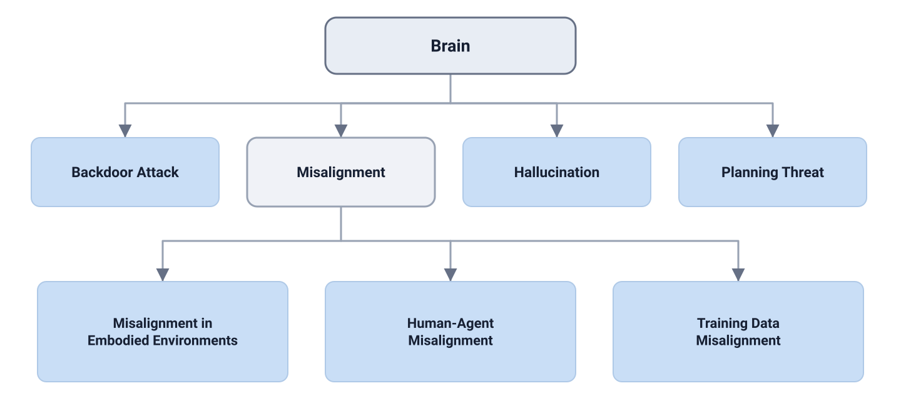

# Brain: quyết định sai từ đâu?

<!--
GHI CHÚ THUYẾT TRÌNH

[click]

Đầu vào hợp lệ chưa chắc dẫn đến quyết định đúng. Phần Brain có bốn nhóm chính: backdoor, misalignment, hallucination và lỗi lập kế hoạch.

Backdoor có điều kiện kích hoạt đã được cài vào mô hình hoặc thành phần liên quan. Các lỗi còn lại có thể xảy ra ngay cả khi không có người tấn công. Tiếp theo sẽ xem từng nhóm và cách phòng thủ.

---

KIỂM CHỨNG NGUỒN — Brain: quyết định sai từ đâu?
Cập nhật: 2026-11-26. Số trang dưới đây là trang PDF của survey, tương ứng 182:n; không phải số slide.

NGUỒN TỔNG QUAN
Zehang Deng, Yongjian Guo, Changzhou Han, Wanlun Ma, Junwu Xiong, Sheng Wen, Yang Xiang (2025). AI Agents Under Threat: A Survey of Key Security Challenges and Future Pathways. ACM Computing Surveys 57(7), Article 182, February 2025. https://doi.org/10.1145/3716628
Vị trí: §3.2; Figure 3, trang 7, 11, 12.
Mở PDF: https://dl.acm.org/doi/pdf/10.1145/3716628#page=7

NỘI DUNG / VÍ DỤ / SƠ ĐỒ
• Bốn nhánh backdoor, misalignment, hallucination, planning theo Figure 3.
  Nguồn: Survey §3.2; Figure 3, tr. 7, 11, 12.

THÔNG TIN ĐẦY ĐỦ CỦA TỪNG NGUỒN DÙNG TRÊN SLIDE
Slide này tổng hợp trực tiếp survey; không sử dụng paper gốc riêng để minh chứng kết quả.
-->
