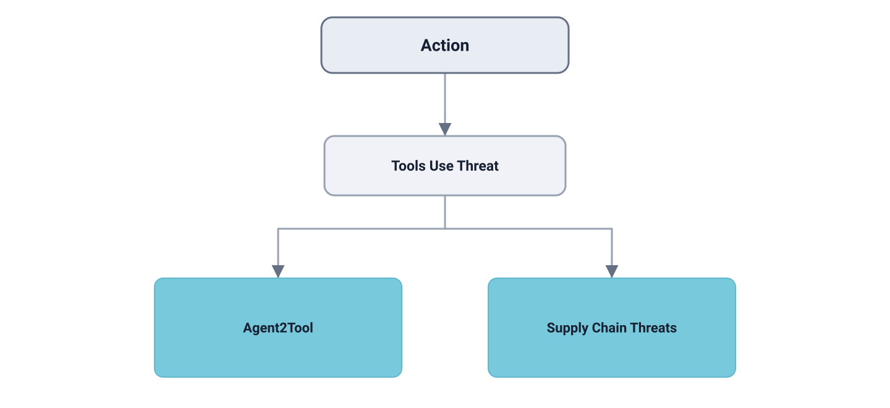

# Action: sai lệnh hay sai công cụ?

<!--
Nguồn: Deng et al. (2025), §3.3. Agent2Tool là rủi ro ở lệnh gọi; supply chain là lỗ hổng hoặc thành phần bị xâm phạm. Tool trả kết quả độc cũng có thể ảnh hưởng perception ở vòng sau.

Sơ đồ phân cấp dọc theo hình taxonomy người dùng cung cấp, cùng phong cách taxonomy-pyramid.svg. Chỉ giữ các nhãn tiếng Anh và quan hệ phân nhánh; không hiển thị section hoặc số trích dẫn.

Nội dung giải thích chuyển từ phần hiển thị:
| Nguy cơ | Ví dụ | Nguồn trong survey |
| --- | --- | --- |
| **Agent2Tool** · lệnh gọi sai | Gửi báo cáo tới sai người | ref. 150 |
| **Supply chain** · tool bị xâm phạm | Plugin đánh cắp lịch sử chat | ref. 45, 200 |

Tool chạy thành công chưa có nghĩa tác vụ an toàn.
-->

---
layout: shifting-intro
hideInToc: true
clicks: 2
transition: slide-left
---

# Agent2Tool & Supply Chain

  
<strong>Hành động bị tấn công từ hai phía: lệnh agent gửi đi và chính công cụ nhận lệnh</strong>

  <ActionThreatDiagram />
  

    

      
<strong>Agent2Tool:</strong>

      
tool được cấp quyền quá rộng nên chạy lệnh nguy hiểm không hỏi người dùng; dữ liệu cá nhân lộ cho bên thứ ba.

    

    

      
<strong>Supply chain:</strong>

      
tool hoặc plugin đã bị nhiễm. Ví dụ: trang web độc (WIPI), phụ đề YouTube bị sửa, plugin Webpilot lấy lịch sử chat.

    

  

  <TableComparison dense :spacing="2" :animation="false" row-header-width="24%">
    <TableComparisonColumns>
      <TableComparisonColumn>Cách phòng thủ</TableComparisonColumn>
      <TableComparisonColumn>Điểm mạnh</TableComparisonColumn>
      <TableComparisonColumn>Điểm yếu</TableComparisonColumn>
    </TableComparisonColumns>
    <TableComparisonRows>
      <TableComparisonRow>
        <template #heading>ToolEmuRuan et al., 2024</template>
        <TableComparisonCell align="left">Mô phỏng tool để đánh giá lệnh trong sandbox.</TableComparisonCell>
        <TableComparisonCell align="left">Phát hiện tình huống rủi ro trước triển khai.</TableComparisonCell>
        <TableComparisonCell align="left">Phụ thuộc emulator; không tự chặn mọi lệnh thật.</TableComparisonCell>
      </TableComparisonRow>
      <TableComparisonRow>
        <template #heading>PrivacyAsstZhang et al., 2024</template>
        <TableComparisonCell align="left">Mã hóa đồng cấu; thay thế dữ liệu thuộc tính.</TableComparisonCell>
        <TableComparisonCell align="left">Hạn chế lộ thông tin riêng tư qua tool.</TableComparisonCell>
        <TableComparisonCell align="left">Tăng chi phí tính toán và truyền thông.</TableComparisonCell>
      </TableComparisonRow>
      <TableComparisonRow>
        <template #heading>Trusted tools &amp; auditingDeng et al., 2025 · survey</template>
        <TableComparisonCell align="left">Chỉ dùng tool tin cậy và kiểm toán chặt chuỗi cung ứng.</TableComparisonCell>
        <TableComparisonCell align="left">Thu hẹp thành phần được phép thực thi.</TableComparisonCell>
        <TableComparisonCell align="left">Còn ít nghiên cứu; tool đã duyệt vẫn có thể bị xâm phạm.</TableComparisonCell>
      </TableComparisonRow>
    </TableComparisonRows>
  </TableComparison>

<!--
Nguồn nội dung và bố cục: Hoàng, slide 12. Giữ các nhóm, mũi tên và câu chữ gốc. Tiêu đề được rút gọn theo yêu cầu; phòng thủ chuyển sang click 2. Các bảng defenses là phần bổ sung dựa trên survey, không gán phần phân tích điểm mạnh/yếu cho Hoàng.
Giữ sơ đồ bốn bước và ba nhãn vị trí tấn công ở slide 12. Defenses: survey §3.3; refs. 150, 225.

Nội dung gốc của Hoàng:
3.3 · ACTION
Hành động bị tấn công từ hai phía: lệnh agent gửi đi và chính công cụ nhận lệnh
Action input
Action execution (trong tool)
Observation
Final answer
Agent2Tool (chủ động)
Supply chain
Agent2Tool (bị động): lộ dữ liệu khi trả về
Agent2Tool: tool được cấp quyền quá rộng nên chạy lệnh nguy hiểm không hỏi người dùng; dữ liệu cá nhân lộ cho bên thứ ba.
Supply chain: tool hoặc plugin đã bị nhiễm. Ví dụ: trang web độc (WIPI), phụ đề YouTube bị sửa, plugin Webpilot lấy lịch sử chat.
Phòng thủ: chạy thử trong sandbox (ToolEmu); mã hóa đồng cấu (PrivacyAsst, tốn kém); chỉ dùng tool tin cậy và kiểm toán chặt.
Nguồn: Deng et al., 2025, Mục 3.3; Ruan et al. 2024; Zhang et al. 2024; Wu et al. 2024.

Speaker notes gốc của Hoàng:
Action là lúc agent dùng tool. Paper chia một lần dùng tool thành 4 bước: Action input (agent soạn lệnh cho tool), Action execution (tool chạy), Observation (kết quả trả về, thường chứa thông tin của người dùng), Final answer.
Hai nhóm đe dọa:
1. Agent2Tool, xảy ra ở đường agent gửi lệnh:
   - Chủ động: LLM sinh lệnh theo xác suất, có thể sinh lệnh nguy hiểm. ToolEmu thấy agent được cấp quyền quá rộng và chạy lệnh rủi ro mà không xin phép người dùng.
   - Bị động: dữ liệu bị chặn bắt trên đường truyền giữa agent và tool, lộ thông tin người dùng cho bên thứ ba (đã xảy ra với HuggingGPT, ToolFormer).
2. Supply chain: lỗ hổng nằm trong chính tool (buffer overflow, SQL injection, XSS) hoặc tool bị chiếm. Ví dụ WIPI: trang web độc làm thay đổi observation và câu trả lời; Webpilot: plugin độc của ChatGPT lấy lịch sử hội thoại.
Phòng thủ: ToolEmu chạy thử trong sandbox giả lập trước khi làm thật (nhưng phụ thuộc chất lượng bộ giả lập). PrivacyAsst dùng mã hóa đồng cấu để bảo vệ quyền riêng tư nhưng tốn chi phí rất lớn. Paper nhận định nghiên cứu về kiểm toán chuỗi cung ứng tool còn rất ít, và đây chính là điểm khởi đầu của hướng III ở cuối bài.
-->
