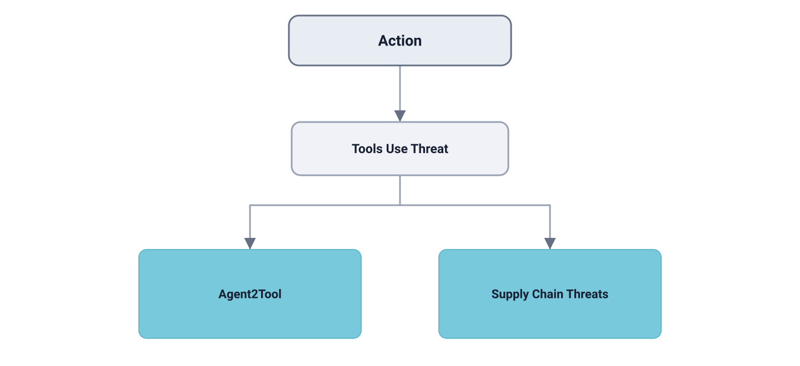

# Action: sai lệnh hay sai công cụ?

<!--
[click]

Action là lúc quyết định trở thành hành động thật. Cần xét cả lệnh agent gửi đi lẫn công cụ nhận lệnh.

Agent2Tool tập trung vào rủi ro khi dùng công cụ; supply chain xét công cụ hoặc thành phần phụ thuộc bị lỗi, bị xâm phạm. Tool báo chạy thành công chưa có nghĩa công việc đã được thực hiện an toàn.

Nguồn: Deng et al. (2025), mục 3.3.
-->
