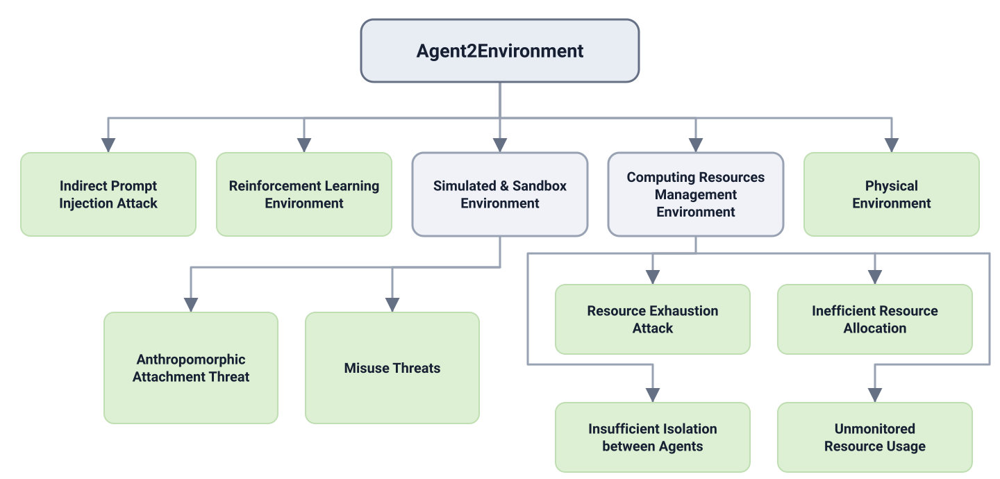

# Environment: rủi ro từ bên ngoài

<!--
GHI CHÚ THUYẾT TRÌNH

[click]

RL là học tăng cường từ phản hồi/phần thưởng. Anthropomorphic attachment là gắn bó có hại do xem agent như con người; misuse là dùng agent vào mục đích gây hại.

Bốn nhánh tài nguyên là cạn kiệt tài nguyên, phân bổ kém, cách ly kém và thiếu giám sát. Các lỗi phân bổ/giám sát không nhất thiết cần kẻ tấn công. Nêu tên nhóm ngắn gọn rồi chuyển sang ví dụ ở các slide tiếp theo.
-->
