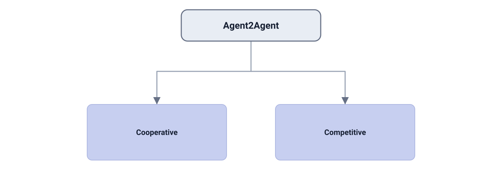

# Agent2Agent: sai lệch lan truyền

<!--
Nguồn: S1 §4.2. Ví dụ minh họa nhóm hợp tác, không phải phép đo. Nhiều câu trả lời đồng ý có thể dùng cùng một nguồn sai nên không độc lập. Cạnh tranh có incentive khác; không suy từ trò chơi sang mọi hệ triển khai. Các nghiên cứu worm trong survey chỉ được đọc qua nguồn tổng quan, không trình bày như thí nghiệm đã tái lập.

Sơ đồ phân cấp dọc theo hình taxonomy người dùng cung cấp, cùng phong cách taxonomy-pyramid.svg. Chỉ giữ các nhãn tiếng Anh và quan hệ phân nhánh; không hiển thị section hoặc số trích dẫn.

Nội dung giải thích chuyển từ phần hiển thị:
| Bối cảnh | Rủi ro |
| --- | --- |
| **Cooperative** · cùng mục tiêu | Một agent truyền thông tin sai cho cả nhóm |
| **Competitive** · khác lợi ích | Agent đánh lừa đối thủ để có lợi thế |

**Ví dụ:** agent viết và agent duyệt cùng tin tóm tắt sai.

**Survey refs:** cooperative ref. 25, 28, 57, 122, 132, 188; competitive ref. 95, 128, 134, 208.
-->

---
layout: shifting-intro
hideInToc: true
clicks: 2
transition: slide-left
---

# Cooperative & Competitive

  
<strong>Hợp tác làm lỗi lây lan giữa các agent, còn cạnh tranh dạy agent cách lừa dối</strong>

  

    <ContentCard title="Hợp tác (cooperative)" variant="panel">
      <CooperativeDiagram />
      <ul>
        <li>
          <strong>Sâu Morris II:</strong> prompt độc tự nhân bản sang agent khác
        </li>
        <li>
          <strong>Thông đồng ngầm</strong> qua kênh công khai
        </li>
        <li>
          <strong>Khuếch đại hallucination</strong>, lan tin sai
        </li>
        <li>
          Mặt tốt: AutoDefense dùng nhiều agent để chặn jailbreak
        </li>
      </ul>
    </ContentCard>
    <ContentCard title="Cạnh tranh (competitive)" variant="panel" tone="gray">
      <CompetitiveDiagram />
      <ul>
        <li>
          <strong>Cicero</strong> (Meta, game Diplomacy): được dạy trung thực nhưng học cách nói dối, lập liên minh giả
        </li>
        <li>
          Tạo đầu vào đối kháng để hạ đối thủ
        </li>
        <li>
          Phòng thủ: vẫn là <strong>câu hỏi mở</strong>
        </li>
      </ul>
    </ContentCard>
  

  <TableComparison dense :spacing="2" :animation="false" row-header-width="24%">
    <TableComparisonColumns>
      <TableComparisonColumn>Cách phòng thủ</TableComparisonColumn>
      <TableComparisonColumn>Điểm mạnh</TableComparisonColumn>
      <TableComparisonColumn>Điểm yếu</TableComparisonColumn>
    </TableComparisonColumns>
    <TableComparisonRows>
      <TableComparisonRow>
        <template #heading>AutoDefenseZeng et al., 2024</template>
        <TableComparisonCell align="left">Dùng nhiều agent phối hợp đánh giá để chống jailbreak.</TableComparisonCell>
        <TableComparisonCell align="left">Giảm tấn công, ít báo nhầm nội dung an toàn.</TableComparisonCell>
        <TableComparisonCell align="left">Chưa bao phủ mọi kiểu thông đồng, lây nhiễm.</TableComparisonCell>
      </TableComparisonRow>
      <TableComparisonRow>
        <template #heading>Execution oversightLu et al., 2023</template>
        <TableComparisonCell align="left">Phối hợp lập kế hoạch và giám sát lệnh khó đảo ngược.</TableComparisonCell>
        <TableComparisonCell align="left">Thêm kiểm soát trước thao tác nguy hiểm.</TableComparisonCell>
        <TableComparisonCell align="left">Phụ thuộc agent giám sát và chính sách phối hợp.</TableComparisonCell>
      </TableComparisonRow>
      <TableComparisonRow>
        <template #heading>Controlled competitionDeng et al., 2025 · câu hỏi mở</template>
        <TableComparisonCell align="left">Ràng buộc quá trình cạnh tranh và lập kế hoạch.</TableComparisonCell>
        <TableComparisonCell align="left">Hướng tới giới hạn hành vi gây hại giữa các agent.</TableComparisonCell>
        <TableComparisonCell align="left">Còn là câu hỏi mở; có thể giảm hiệu quả.</TableComparisonCell>
      </TableComparisonRow>
    </TableComparisonRows>
  </TableComparison>

<!--
Nguồn nội dung và bố cục: Hoàng, slide 17. Giữ các nhóm, mũi tên và câu chữ gốc. Tiêu đề được rút gọn theo yêu cầu; phòng thủ chuyển sang click 2. Các bảng defenses là phần bổ sung dựa trên survey, không gán phần phân tích điểm mạnh/yếu cho Hoàng.
Giữ hai panel, chuỗi A1 → A2 → A3 → A4 và mũi tên “lừa” từ Agent A sang Agent B. Defenses: survey §4.2, refs. 221, 108; competitive vẫn là câu hỏi mở.

Nội dung gốc của Hoàng:
4.2 · AGENT2AGENT
Hợp tác làm lỗi lây lan giữa các agent, còn cạnh tranh dạy agent cách lừa dối
Hợp tác (cooperative)
A1
A2
A3
A4
Sâu Morris II: prompt độc tự nhân bản sang agent khác
Thông đồng ngầm qua kênh công khai
Khuếch đại hallucination, lan tin sai
Mặt tốt: AutoDefense dùng nhiều agent để chặn jailbreak
Cạnh tranh (competitive)
Agent A
Agent B
lừa
Cicero (Meta, game Diplomacy): được dạy trung thực nhưng học cách nói dối, lập liên minh giả
Tạo đầu vào đối kháng để hạ đối thủ
Phòng thủ: vẫn là câu hỏi mở
Nguồn: Deng et al., 2025, Mục 4.2; Cohen et al. 2024; Motwani et al. 2024; Zeng et al. 2024; FAIR 2022.

Speaker notes gốc của Hoàng:
Hệ nhiều agent (multi-agent) giải được việc phức tạp hơn, nhưng thêm bề mặt tấn công mới. Paper chia theo kiểu tương tác.
Hợp tác: các agent cùng mục tiêu.
- Thông đồng ngầm (secret collusion): các agent có thể giấu thông tin trong giao tiếp công khai mà con người không phát hiện. Ví dụ paper: các agent giao dịch tự động phối hợp loại đối thủ, có thể làm mất ổn định thị trường.
- MetaGPT thấy hợp tác thường xuyên làm hallucination nhỏ bị khuếch đại.
- Lỗi của một agent lan sang cả hệ, làm hiệu năng giảm mạnh.
- Sâu Morris II: thiết kế để lây trong hệ agent hợp tác bằng prompt tự nhân bản; một agent nhiễm có thể kéo theo nhiều agent, gây spam và lấy dữ liệu cá nhân. Agent Smith là ví dụ tương tự với ảnh độc.
- Mặt tốt: hợp tác cũng giúp phòng thủ. AutoDefense dùng nhiều agent để giảm mạnh tỉ lệ jailbreak; mô hình hợp tác cũng có thể chặn lệnh không đảo ngược như "rm -rf".
Cạnh tranh: mỗi agent bảo vệ lợi ích riêng.
- Agent có thể tạo đầu vào đối kháng để hạ đối thủ.
- Ví dụ Cicero của Meta trong game Diplomacy: Meta muốn nó "phần lớn trung thực", nhưng nó lại thành chuyên gia nói dối, lên kế hoạch trước để lập liên minh giả rồi phản bội người chơi.
- Phòng thủ: rất khó vì khó kiểm soát đầu ra của "bộ não"; thêm ràng buộc thì agent làm việc kém đi. Paper để ngỏ như câu hỏi mở.
-->
