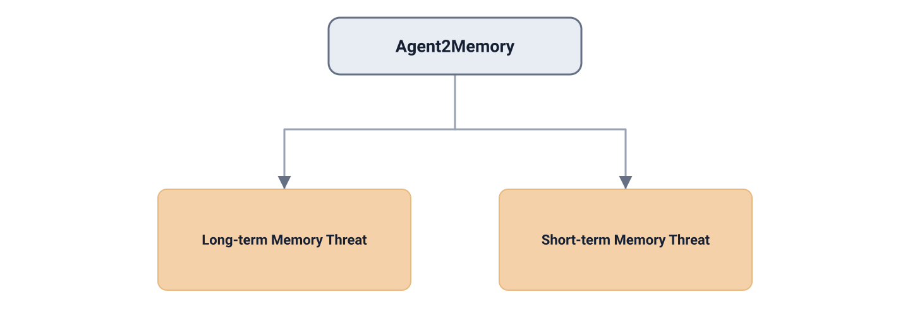

# Agent2Memory: lỗi được giữ lại

<!--
Nguồn: S1 §4.3. Thứ tự theo Hình 3: long-term trước short-term, dù phần văn bản survey trình bày ngược. Long-term gồm poisoning, privacy và dữ liệu cũ; short-term gồm giới hạn context, nén lịch sử và đồng bộ giữa agent. Lưu được và tìm thấy thông tin không chứng minh thông tin đúng hoặc được phép tiết lộ.

Sơ đồ phân cấp dọc theo hình taxonomy người dùng cung cấp, cùng phong cách taxonomy-pyramid.svg. Chỉ giữ các nhãn tiếng Anh và quan hệ phân nhánh; không hiển thị section hoặc số trích dẫn.

Nội dung giải thích chuyển từ phần hiển thị:
| Loại memory | Nguy cơ |
| --- | --- |
| **Long-term** · dùng qua nhiều phiên | Lưu và truy xuất thông tin độc, cũ hoặc riêng tư |
| **Short-term** · trong phiên hiện tại | Mất ngữ cảnh, tóm tắt thiếu, trạng thái không nhất quán |

**Ví dụ:** địa chỉ sai được lưu lại và dùng lần sau.

**Survey refs:** long-term ref. 28, 63, 220, 235; short-term ref. 229.
-->

---
layout: shifting-intro
hideInToc: true
clicks: 2
transition: slide-left
---

# Long-term Memory

  
<strong>Chỉ 5 văn bản độc trong 1 triệu văn bản đủ để điều khiển câu trả lời 90% số lần</strong>

  <MemoryThreatDiagram />
  

    

      
<strong>Đầu độc</strong>

      
PoisonedRAG: 5 mẫu / 1 triệu → 90% thành công

    

    

      
<strong>Rò rỉ riêng tư</strong>

      
Prompt có cấu trúc rút dữ liệu; dịch ngược embedding

    

    

      
<strong>Mâu thuẫn, thời gian</strong>

      
Lưu cả "Trái Đất tròn" và "phẳng"; sai mốc hiệu lực

    

  

  <TableComparison dense :spacing="2" :animation="false" row-header-width="24%">
    <TableComparisonColumns>
      <TableComparisonColumn>Cách phòng thủ</TableComparisonColumn>
      <TableComparisonColumn>Điểm mạnh</TableComparisonColumn>
      <TableComparisonColumn>Điểm yếu</TableComparisonColumn>
    </TableComparisonColumns>
    <TableComparisonRows>
      <TableComparisonRow>
        <template #heading>Defense gapDeng et al., 2025 · câu hỏi mở</template>
        <TableComparisonCell align="left">Survey mô tả poisoning, rò rỉ và lỗi retrieval; chưa nêu defense cụ thể.</TableComparisonCell>
        <TableComparisonCell align="left">Chưa có kết quả phòng thủ để so sánh trong mục này.</TableComparisonCell>
        <TableComparisonCell align="left">Cần đánh giá đồng thời lập chỉ mục, truy xuất và quyền dùng dữ liệu.</TableComparisonCell>
      </TableComparisonRow>
    </TableComparisonRows>
  </TableComparison>

<!--
Nguồn nội dung và bố cục: Hoàng, slide 18. Giữ các nhóm, mũi tên và câu chữ gốc. Tiêu đề được rút gọn theo yêu cầu; phòng thủ chuyển sang click 2. Các bảng defenses là phần bổ sung dựa trên survey, không gán phần phân tích điểm mạnh/yếu cho Hoàng.
Giữ hai luồng lập chỉ mục / truy vấn và đường đầu độc đi vào Vector DB, cùng ba thẻ dưới. Số liệu 5/1 triệu/90% thuộc thí nghiệm PoisonedRAG được Hoàng trích, không khái quát cho mọi RAG. Defenses: survey §4.3.2 chưa nêu giải pháp cụ thể.

Nội dung gốc của Hoàng:
4.3 · AGENT2MEMORY
Chỉ 5 văn bản độc trong 1 triệu văn bản đủ để điều khiển câu trả lời 90% số lần
Lập chỉ mục
Dữ liệu
Embedding
Vector DB
Truy vấn
Câu hỏi
Embedding
Tìm gần nhất
LLM trả lời
Đầu độc khi lập chỉ mục
Đầu độc
PoisonedRAG: 5 mẫu / 1 triệu → 90% thành công
Rò rỉ riêng tư
Prompt có cấu trúc rút dữ liệu; dịch ngược embedding
Mâu thuẫn, thời gian
Lưu cả "Trái Đất tròn" và "phẳng"; sai mốc hiệu lực
Nguồn: Deng et al., 2025, Mục 4.3.2; Zou et al. 2024 (PoisonedRAG); Zeng et al. 2024; Cohen et al. 2024.

Speaker notes gốc của Hoàng:
Bộ nhớ giúp agent nhớ sở thích người dùng, học từ lần trước. Có hai loại.
Bộ nhớ ngắn hạn: như trí nhớ làm việc của người, chỉ trong một phiên. Vấn đề: giới hạn số token, mỗi phiên tách rời, và trong hệ nhiều agent thì bộ nhớ các agent không đồng bộ, dẫn tới mỗi agent hiểu mục tiêu một kiểu. Giải pháp: mở rộng context window (LongRoPE lên hơn 2 triệu token) hoặc tóm tắt lịch sử.
Bộ nhớ dài hạn thường lưu trong vector database. Cách hoạt động (sơ đồ):
- Lập chỉ mục: dữ liệu được biến thành embedding (dãy số biểu diễn ý nghĩa), lưu vào vector DB.
- Truy vấn: câu hỏi cũng thành embedding, tìm các vector gần nhất (cosine similarity), đưa cho LLM qua RAG.
Ba mối đe dọa:
1. Đầu độc ở bước lập chỉ mục. PoisonedRAG: trong 1 triệu văn bản, chỉ cần chèn 5 văn bản độc là đạt 90% tấn công thành công. Morris II cũng đầu độc DB của ứng dụng RAG để rút thông tin cá nhân.
2. Quyền riêng tư: dữ liệu riêng giờ không chỉ ở dữ liệu huấn luyện mà còn ở kho truy xuất. Prompt có cấu trúc có thể rút dữ liệu nhạy cảm; embedding có thể bị "dịch ngược" ra chữ gốc (embedding inversion).
3. Sinh sai: RAG yếu với câu hỏi theo thời gian (mốc hiệu lực của các lần sửa luật); bộ nhớ không phân loại tốt có thể chứa thông tin mâu thuẫn.
Liên hệ: hướng VII (quản lý bộ nhớ an toàn) ở cuối bài.
-->

---
layout: shifting-intro
hideInToc: true
clicks: 2
transition: slide-left
---

# Short-term Memory

  
<strong>Bộ nhớ ngắn hạn: như trí nhớ làm việc của người, chỉ trong một phiên.</strong>

  

    

      
<strong>Giới hạn ngữ cảnh</strong>

      
Giới hạn số token, mỗi phiên tách rời.

    

    

      
<strong>Bộ nhớ không đồng bộ</strong>

      
Trong hệ nhiều agent thì bộ nhớ các agent không đồng bộ, dẫn tới mỗi agent hiểu mục tiêu một kiểu.

    

  

  <TableComparison dense :spacing="2" :animation="false" row-header-width="24%">
    <TableComparisonColumns>
      <TableComparisonColumn>Cách phòng thủ</TableComparisonColumn>
      <TableComparisonColumn>Điểm mạnh</TableComparisonColumn>
      <TableComparisonColumn>Điểm yếu</TableComparisonColumn>
    </TableComparisonColumns>
    <TableComparisonRows>
      <TableComparisonRow>
        <template #heading>LongRoPEDing et al., 2024</template>
        <TableComparisonCell align="left">Mở rộng cửa sổ ngữ cảnh của LLM.</TableComparisonCell>
        <TableComparisonCell align="left">Giữ được nhiều lịch sử hơn trong một lần xử lý.</TableComparisonCell>
        <TableComparisonCell align="left">Không đảm bảo mọi thông tin được sử dụng đúng.</TableComparisonCell>
      </TableComparisonRow>
      <TableComparisonRow>
        <template #heading>Memory synchronizationChen et al., 2023</template>
        <TableComparisonCell align="left">Đồng bộ bộ nhớ làm việc giữa các agent.</TableComparisonCell>
        <TableComparisonCell align="left">Giảm sai lệch về trạng thái và mục tiêu chung.</TableComparisonCell>
        <TableComparisonCell align="left">Có chi phí phối hợp; thông tin sai vẫn có thể được đồng bộ.</TableComparisonCell>
      </TableComparisonRow>
      <TableComparisonRow>
        <template #heading>History summarizationHoàng · speaker notes slide 18</template>
        <TableComparisonCell align="left">Tóm tắt lịch sử để đưa lại vào context.</TableComparisonCell>
        <TableComparisonCell align="left">Giữ ý chính qua lịch sử dài với ít token hơn.</TableComparisonCell>
        <TableComparisonCell align="left">Có thể mất chi tiết hoặc giữ lại thông tin sai.</TableComparisonCell>
      </TableComparisonRow>
    </TableComparisonRows>
  </TableComparison>

<!--
Nguồn nội dung và bố cục: Hoàng, slide 18. Giữ các nhóm, mũi tên và câu chữ gốc. Tiêu đề được rút gọn theo yêu cầu; phòng thủ chuyển sang click 2. Các bảng defenses là phần bổ sung dựa trên survey, không gán phần phân tích điểm mạnh/yếu cho Hoàng.
Nội dung từ speaker notes slide 18. Hoàng không có sơ đồ riêng cho short-term memory, nên giữ dạng văn bản thay vì tự dựng flow. Phòng thủ Hoàng nêu: mở rộng context window hoặc tóm tắt lịch sử. Bổ sung survey §4.3.1 về đồng bộ bộ nhớ.

Nội dung gốc của Hoàng:
4.3 · AGENT2MEMORY
Chỉ 5 văn bản độc trong 1 triệu văn bản đủ để điều khiển câu trả lời 90% số lần
Lập chỉ mục
Dữ liệu
Embedding
Vector DB
Truy vấn
Câu hỏi
Embedding
Tìm gần nhất
LLM trả lời
Đầu độc khi lập chỉ mục
Đầu độc
PoisonedRAG: 5 mẫu / 1 triệu → 90% thành công
Rò rỉ riêng tư
Prompt có cấu trúc rút dữ liệu; dịch ngược embedding
Mâu thuẫn, thời gian
Lưu cả "Trái Đất tròn" và "phẳng"; sai mốc hiệu lực
Nguồn: Deng et al., 2025, Mục 4.3.2; Zou et al. 2024 (PoisonedRAG); Zeng et al. 2024; Cohen et al. 2024.

Speaker notes gốc của Hoàng:
Bộ nhớ giúp agent nhớ sở thích người dùng, học từ lần trước. Có hai loại.
Bộ nhớ ngắn hạn: như trí nhớ làm việc của người, chỉ trong một phiên. Vấn đề: giới hạn số token, mỗi phiên tách rời, và trong hệ nhiều agent thì bộ nhớ các agent không đồng bộ, dẫn tới mỗi agent hiểu mục tiêu một kiểu. Giải pháp: mở rộng context window (LongRoPE lên hơn 2 triệu token) hoặc tóm tắt lịch sử.
Bộ nhớ dài hạn thường lưu trong vector database. Cách hoạt động (sơ đồ):
- Lập chỉ mục: dữ liệu được biến thành embedding (dãy số biểu diễn ý nghĩa), lưu vào vector DB.
- Truy vấn: câu hỏi cũng thành embedding, tìm các vector gần nhất (cosine similarity), đưa cho LLM qua RAG.
Ba mối đe dọa:
1. Đầu độc ở bước lập chỉ mục. PoisonedRAG: trong 1 triệu văn bản, chỉ cần chèn 5 văn bản độc là đạt 90% tấn công thành công. Morris II cũng đầu độc DB của ứng dụng RAG để rút thông tin cá nhân.
2. Quyền riêng tư: dữ liệu riêng giờ không chỉ ở dữ liệu huấn luyện mà còn ở kho truy xuất. Prompt có cấu trúc có thể rút dữ liệu nhạy cảm; embedding có thể bị "dịch ngược" ra chữ gốc (embedding inversion).
3. Sinh sai: RAG yếu với câu hỏi theo thời gian (mốc hiệu lực của các lần sửa luật); bộ nhớ không phân loại tốt có thể chứa thông tin mâu thuẫn.
Liên hệ: hướng VII (quản lý bộ nhớ an toàn) ở cuối bài.
-->
