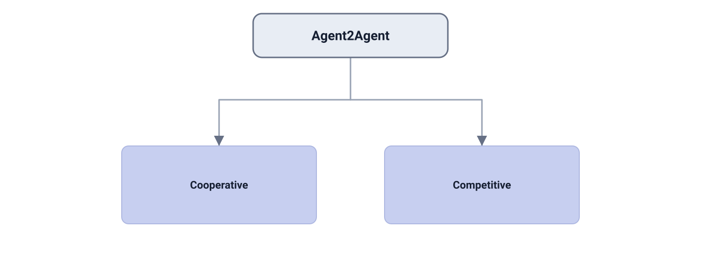

# Agent2Agent: sai lệch lan truyền

<!--
GHI CHÚ THUYẾT TRÌNH

[click]

Phân biệt hợp tác vì cùng mục tiêu và cạnh tranh vì khác lợi ích. Nhiều câu trả lời đồng ý có thể dùng cùng một nguồn sai nên không độc lập.

Ví dụ minh họa: agent viết và agent duyệt cùng tin một bản tóm tắt sai. Đây là minh họa, không phải phép đo. Không suy kết quả trong một trò chơi sang mọi hệ triển khai.

---

KIỂM CHỨNG NGUỒN — Agent2Agent: sai lệch lan truyền
Cập nhật: 2026-11-26. Số trang dưới đây là trang PDF của survey, tương ứng 182:n; không phải số slide.

NGUỒN TỔNG QUAN
Zehang Deng, Yongjian Guo, Changzhou Han, Wanlun Ma, Junwu Xiong, Sheng Wen, Yang Xiang (2025). AI Agents Under Threat: A Survey of Key Security Challenges and Future Pathways. ACM Computing Surveys 57(7), Article 182, February 2025. https://doi.org/10.1145/3716628
Vị trí: §4.2; Figure 3, trang 7, 21, 22.
Mở PDF: https://dl.acm.org/doi/pdf/10.1145/3716628#page=7

NỘI DUNG / VÍ DỤ / SƠ ĐỒ
• Hai nhánh hợp tác và cạnh tranh; sơ đồ và ví dụ nhóm cùng tin thông tin sai là minh họa.
  Nguồn: Survey §4.2; Figure 3, tr. 7, 21, 22.

THÔNG TIN ĐẦY ĐỦ CỦA TỪNG NGUỒN DÙNG TRÊN SLIDE
Slide này tổng hợp trực tiếp survey; không sử dụng paper gốc riêng để minh chứng kết quả.
-->
