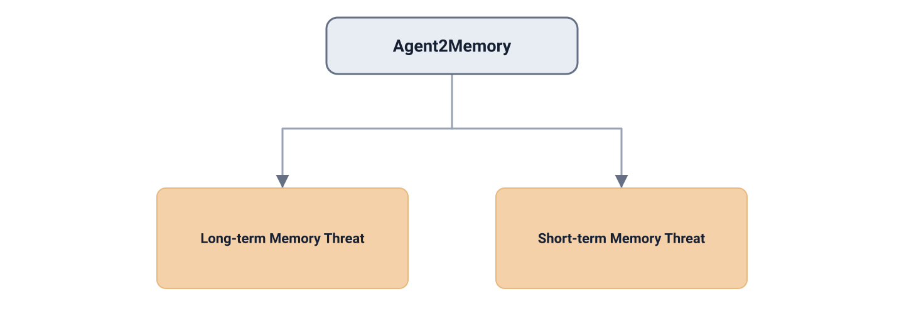

# Agent2Memory: lỗi được giữ lại

<!--
GHI CHÚ THUYẾT TRÌNH

[click]

Trình bày long-term trước short-term theo Hình 3; văn bản survey đi theo thứ tự ngược lại.

Long-term dùng qua nhiều phiên: có thể lưu và truy xuất thông tin độc, cũ hoặc riêng tư. Short-term dùng trong phiên: có thể mất ngữ cảnh, tóm tắt thiếu hoặc giữ trạng thái không nhất quán.

Lưu được và tìm thấy thông tin không chứng minh thông tin đúng hoặc được phép tiết lộ. Ví dụ minh họa: địa chỉ sai được lưu lại và dùng lần sau.
-->
