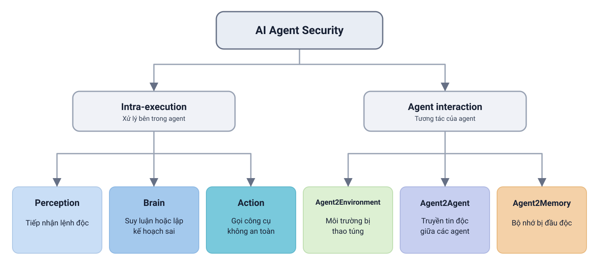

# Bản đồ an ninh AI Agent

<!--
GHI CHÚ THUYẾT TRÌNH

[click]

Sơ đồ chia rủi ro thành hai nhánh: xử lý bên trong agent và tương tác với bên ngoài. Mỗi nhánh có ba nhóm.

Đây là cách phân loại, không phải thứ tự các bước. Một cuộc tấn công có thể đi qua nhiều nhóm: lệnh độc từ web ảnh hưởng suy luận, được lưu vào bộ nhớ rồi dẫn đến gọi tool sai. Màu chỉ để phân biệt nhóm.
-->
